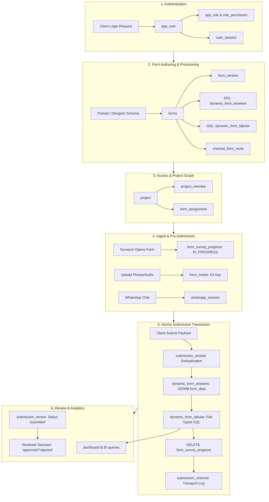

# Database Tables, Interconnections & Dataflow Architecture

This document provides a comprehensive reference of all database tables across all modules in the platform, their schema definitions, cross-table relationships, and the end-to-end data flow that coordinates them.

---

## 1. Modular Architecture Overview

The system is split into **Core** (the platform) and independent **Modules**. Each module owns its own schema, migrations, routes, and permissions, registering via a manifest (`MODULE`) in its package:

```
Platform Architecture
├── Core Platform              (Accounts, RBAC, Sessions, Security)
├── Forms Module               (Form definitions, Versioning, Dynamic tables, Ingestion)
├── Projects Module            (Tenant isolation, Teams, Assignments, Review workflows)
├── Dashboards Module          (BI widgets, Analytics data sources, Versioning)
├── Client Catalog Module      (User-defined controlled vocabularies & cascading lists)
└── Standards Modules
    ├── SEOnt / Ontology       (Semantic concept URIs & subclass hierarchies)
    ├── ICASA / Data Standards (Standardized agronomic variables & units)
    ├── Crop Ontology          (Crop-specific trait-method-scale-variable trees)
    └── Units                  (Dimensional conversions & base-unit mathematics)
```

---

## 2. Table Catalog by Module

### 2.1 Core Module (`app/core`)
Manages system-level identities, access control, and user sessions.

| Table Name | Primary Key | Foreign Keys / References | Description |
| :--- | :--- | :--- | :--- |
| **`app_role`** | `role_id` (VARCHAR) | None | System and custom user-defined roles (e.g., `admin`, `editor`, `standard`). |
| **`role_permission`** | `(role_id, permission)` | `role_id` → `app_role(role_id)` | Maps permissions (e.g., `forms.build`, `users.manage`) to roles. |
| **`app_user`** | `user_id` (VARCHAR) | `role_id` → `app_role(role_id)` | User accounts, credentials (bcrypt hashes), account state, lockout counters. |
| **`user_session`** | `token_hash` (CHAR 64) | `user_id` → `app_user(user_id)` | Active bearer sessions with SHA-256 token hashes and expiration timestamps. |
| **`password_reset`** | `token_hash` (CHAR 64) | `user_id` → `app_user(user_id)` | One-time password reset tokens. |

---

### 2.2 Forms Module (`app/modules/forms`)
Owns form definitions, revisions, response ingest pipelines, and multichannel routing.

#### Fixed Module Tables

| Table Name | Primary Key | Foreign Keys / References | Description |
| :--- | :--- | :--- | :--- |
| **`forms`** | `form_id` (VARCHAR) | `parent_id` → `forms(form_id)`<br>`project_id` → `project(project_id)` | Canonical form metadata, current published JSON schema (`form_json`), and public sharing tokens. |
| **`form_version`** | `version_id` (SERIAL) | `form_id` → `forms(form_id)` | Append-only historical snapshots of `form_json` per revision number (`version_no`). |
| **`form_view`** | `form_id` (VARCHAR) | `form_id` → `forms(form_id)` | Custom field visibility and presentation settings for non-editor users. |
| **`standard_form_library`**| `standard_id` (VARCHAR) | `form_id` → `forms(form_id)` (nullable) | Reusable standard form templates that stand independently even if the original form is deleted. |
| **`data_dictionary`** | `entry_id` (VARCHAR) | None | System-wide variable definitions enforcing consistent field types, validation rules, and aliases across forms. |
| **`form_media`** | `media_id` (VARCHAR) | `form_id` → `forms(form_id)` | Uploaded attachments (images, audio, files) stored in S3, keyed by `(form_id, survey_id)`. |
| **`form_survey_progress`** | `(form_id, survey_id)` | `form_id` → `forms(form_id)` | Ephemeral state tracking surveys that have started (`IN_PROGRESS`) prior to submission. |
| **`submission_receipt`** | `(form_id, client_submission_id)` | `form_id` → `forms(form_id)` | Idempotency guard storing submission hashes to deduplicate retried network requests. |
| **`submission_channel`** | `(form_id, survey_id)` | `form_id` → `forms(form_id)` | Records the transport channel (`mobile`, `whatsapp`, `ivr`) for non-web submissions. |
| **`channel_form_route`** | `route_id` (SERIAL) | `form_id` → `forms(form_id)`<br>`project_id` → `project(project_id)` | Maps inbound WhatsApp keywords or IVR menu keys to target forms. |
| **`channel_identity`** | `(channel, identity)` | `user_id` → `app_user(user_id)` | Links incoming phone numbers / sender identities to authenticated platform accounts. |
| **`channel_settings`** | `settings_id` (SERIAL) | `project_id` → `project(project_id)` | Per-project operational parameters (session timeout, encrypted API gateway tokens). |
| **`webhook_config`** | `webhook_id` (VARCHAR) | `project_id` → `project(project_id)` | Inbound gateway webhooks (e.g., Picky Assist, WhatsApp Cloud API). |
| **`whatsapp_session`** | `session_id` (VARCHAR) | `form_id` → `forms(form_id)` | Active conversational chatbot state, validated partial answers, and language tracking. |
| **`form_export`** | `export_id` (SERIAL) | `form_id` → `forms(form_id)` | Tracks form delivery to downstream endpoints (e.g., MCDC connectors). |

#### Dynamic Tables (Provisioned Per Form)

For every saved form (e.g. form titled *"Farmer Registration"* with table name `farmer_registration`):

| Table Name | Primary Key | Fixed Columns | Description |
| :--- | :--- | :--- | :--- |
| **`<form_name>`** | `survey_id` (VARCHAR 50) | `survey_id`, `form_id`, `form_data` (JSONB), `created_on`, `form_version`, `created_by`, (optional `parent_survey_id`, `location`) | **Permanent storage**: Never altered as questions change. All answers reside in `form_data`. |
| **`<form_name>_tabular`** | `survey_id` (VARCHAR 50) | `survey_id`, `form_id`, `form_version`, `created_on`, `created_by`, plus **one typed SQL column per question** | **Disposable projection**: Automatically synchronized or rebuilt from `form_data` for SQL reporting and dashboards. Columns are never dropped. |

---

### 2.3 Projects Module (`app/modules/projects`)
Enforces multi-tenancy, granular per-project RBAC, team grouping, form assignment, and submission review workflows.

| Table Name | Primary Key | Foreign Keys / References | Description |
| :--- | :--- | :--- | :--- |
| **`project`** | `project_id` (VARCHAR) | None | Project entity grouping forms, members, dashboards, and submissions. |
| **`project_member`** | `member_id` (BIGSERIAL) | `project_id` → `project(project_id)`<br>`user_id` → `app_user(user_id)`<br>`role_id` → `app_role(role_id)` | Assigns users to projects with project-specific roles (e.g., Manager, Surveyor). |
| **`project_group`** | `group_id` (VARCHAR) | `project_id` → `project(project_id)` | Sub-teams within a project (e.g., "District Enumerators North"). |
| **`project_group_member`**| `(group_id, user_id)` | `group_id` → `project_group(group_id)`<br>`user_id` → `app_user(user_id)` | Membership mapping of users within project teams. |
| **`form_assignment`** | `assignment_id` (BIGSERIAL)| `form_id` → `forms(form_id)`<br>`user_id` → `app_user(user_id)`<br>`group_id` → `project_group(group_id)` | Form access grants targeted to `everyone`, a specific `user`, or a `group`. |
| **`submission_review`** | `(form_id, survey_id)` | `form_id` → `forms(form_id)` | Workflow state machine tracking submissions through `draft` → `submitted` → `under_review` → `approved` / `rejected`. |

---

### 2.4 Dashboards Module (`app/modules/dashboards`)
Supports BI reporting and widgets over tabular form projections and imported datasets.

| Table Name | Primary Key | Foreign Keys / References | Description |
| :--- | :--- | :--- | :--- |
| **`dashboard`** | `dashboard_id` (VARCHAR)| `project_id` → `project(project_id)` | Dashboard layout, widgets config (`dashboard_json`), and public sharing tokens. |
| **`dashboard_version`** | `(dashboard_id, version_no)` | `dashboard_id` → `dashboard(dashboard_id)` | Immutable version history snapshots of dashboards. |
| **`dashboard_data_source`**| `table_name` (VARCHAR) | `project_id` → `project(project_id)` | Registry of project-scoped external data sources (Excel uploads, external imports). |

---

### 2.5 Client Catalog Module (`app/modules/client_catalog`)
Client-curated, authoritative controlled vocabularies (e.g., crop varieties, administrative divisions).

| Table Name | Primary Key | Foreign Keys / References | Description |
| :--- | :--- | :--- | :--- |
| **`client_catalog`** | `catalog_id` (VARCHAR) | `parent_catalog_id` → `client_catalog(catalog_id)` | Catalog metadata, hierarchy links (e.g., Districts under States). |
| **`client_catalog_value`** | `value_id` (BIGSERIAL) | `catalog_id` → `client_catalog(catalog_id)` | Allowed code/label pairs, multilingual labels (`labels` JSONB), and parent codes. |

---

### 2.6 Standards Modules (`app/modules/standards/*`)

#### A. SEOnt / Ontology (`standards/seont`)
Semantic grounding connecting fields to formal agricultural concepts.
- **`ontology_concept`**: Standard concepts (`concept_uri`, `label`, `definition`).
- **`ontology_relation`**: Directed subclass/parent-child edges between concepts (`parent_uri`, `child_uri`, `relation_type`).

#### B. ICASA / Data Standards (`standards/icasa`)
Agronomic variable registries (ICASA, AgMIP).
- **`data_standard`**: Registry of standard dictionaries.
- **`standard_variable`**: Official variables (`external_id`, `code`, `name`, `unit`, `data_type`).
- **`standard_variable_option`**: Coded valid values for categorized variables.

#### C. Crop Ontology (`standards/crop_ontology`)
Crop-specific trait-method-scale-variable hierarchies.
- **`crop_ontology`**: Crop-specific ontology container (e.g., Maize CO_322).
- **`crop_trait`**: Biological trait being observed.
- **`crop_method`**: Measurement procedure.
- **`crop_scale`**: Measurement unit or category scale.
- **`crop_variable`**: Composed variable linking trait, method, and scale.

#### D. Units (`standards/units`)
Deterministic mathematical unit conversions.
- **`unit`**: Conversion equations (`base_value = value * factor + offset`) across measurement dimensions (`length`, `mass`, `temperature`).

---

## 3. Entity Relationships & Interconnection Map

```mermaid
erDiagram
    app_role ||--o{ role_permission : defines
    app_role ||--o{ app_user : assigns_system_role
    app_role ||--o{ project_member : assigns_project_role

    app_user ||--o{ user_session : signs_in
    app_user ||--o{ project_member : participates
    app_user ||--o{ project_group_member : belongs_to
    app_user ||--o{ channel_identity : mapped_from_phone

    project ||--o{ project_member : contains
    project ||--o{ project_group : contains
    project ||--o{ forms : scopes
    project ||--o{ dashboard : contains
    project ||--o{ dashboard_data_source : registers

    project_group ||--o{ project_group_member : groups
    project_group ||--o{ form_assignment : assigned_target

    forms ||--o{ form_version : versions
    forms ||--o{ form_assignment : assigns_access
    forms ||--o{ form_media : stores_attachments
    forms ||--o{ form_survey_progress : tracks_in_progress
    forms ||--o{ submission_receipt : guards_idempotency
    forms ||--o{ submission_channel : logs_channel
    forms ||--o{ submission_review : tracks_workflow
    forms ||--o{ channel_form_route : routes_traffic
    forms ||--o{ dynamic_form_answers : stores_answers
    forms ||--o{ dynamic_form_tabular : projects_flat

    client_catalog ||--o{ client_catalog_value : contains
    client_catalog ||--o{ client_catalog : parent_hierarchy

    data_standard ||--o{ standard_variable : defines
    standard_variable ||--o{ standard_variable_option : allows_options

    crop_ontology ||--o{ crop_trait : defines
    crop_ontology ||--o{ crop_method : defines
    crop_ontology ||--o{ crop_scale : defines
    crop_ontology ||--o{ crop_variable : defines
```



---

## 4. End-to-End Data Flow

The diagram below maps how data enters the platform, transitions between tables, and finishes in projections and review states:



---

### Step-by-Step Data Flow Breakdown

#### Step 1: Authentication & Authorization
1. Incoming credentials (email + password) are validated against `app_user`.
2. A cryptographically hashed session token is inserted into `user_session`.
3. Platform permissions are resolved from `app_role` and `role_permission`.
4. If accessing a project, `project_member` resolves the user’s scoped role within that specific project.

#### Step 2: Form Authoring & Dynamic Table Generation
1. The builder creates or updates a form definition JSON.
2. The definition is validated against the data dictionary (`data_dictionary`), client catalogs (`client_catalog`), and agronomic standards (`standard_variable`, `crop_variable`).
3. The row in `forms` is updated/created, and a revision is appended to `form_version`.
4. The database automatically executes DDL:
   - `<form_name>` is created with fixed envelope columns (`survey_id`, `form_id`, `form_data`, `created_on`, `form_version`, `created_by`).
   - `<form_name>_tabular` is created or synchronized with typed SQL columns matching all defined question keys.
5. If inbound messaging routes are set, `channel_form_route` is updated.

#### Step 3: Project Organization & Role-Based Assignment
1. The form is bound to a `project(project_id)`.
2. Project administrators grant form access via `form_assignment` to:
   - `everyone` in the project,
   - individual users (`user_id`), or
   - specific field teams (`group_id` via `project_group`).

#### Step 4: Survey Staging & Media Upload
1. When a surveyor initiates data collection or prepares an upload, `submission_service.start()` issues the next sequential `survey_id` from `seq_survey_<form_id>`.
2. A staging entry is placed into `form_survey_progress` (`IN_PROGRESS`).
3. Binary uploads (photos, audio) are streamed to S3, and references are inserted into `form_media` tagged with `(form_id, survey_id)`.
4. Conversational WhatsApp sessions maintain partial answer state in `whatsapp_session`.

#### Step 5: Submission Ingestion (Single Atomic Transaction)
When the final payload is posted, `submission_service._write()` executes the entire state transition in **one PostgreSQL transaction**:
1. **Idempotency Guard**: Inserts `(form_id, client_submission_id)` into `submission_receipt`. If duplicate answers arrive, the transaction replays the previous receipt without duplicate writes.
2. **Canonical Persistence**: Inserts the validated answers as a JSONB object into `<form_name>.form_data`.
3. **Tabular Projection**: Extracts question answers and inserts a typed row into `<form_name>_tabular`.
4. **State Transition**: Deletes the active record from `form_survey_progress` (marking it formally `SUBMITTED`).
5. **Channel Logging**: Records whether the submission originated from `mobile`, `whatsapp`, or `ivr` into `submission_channel`.

#### Step 6: Post-Submission Workflow & Reporting
1. `submission_review` initializes the submission’s lifecycle status as `'submitted'`.
2. Project reviewers inspect responses via review queues and transition the status to `'under_review'`, `'approved'`, or `'rejected'`.
3. The flat `<form_name>_tabular` table serves SQL queries to `dashboard` widgets without needing runtime JSON unpacking.

---

## 5. Architectural Invariants

- **Separation of Definition vs. Data**: Form structures evolve quickly in `forms.form_json` and `form_version`. Answer tables (`<form_name>`) maintain exactly six fixed envelope columns, preventing breaking database migrations during form redesigns.
- **Projections are Disposable**: The `<form_name>_tabular` table is strictly a read projection. It can be wiped and fully regenerated from `<form_name>.form_data` at any point using `tabular_service.rebuild()`.
- **RBAC Decoupling**: System roles (`app_role` via `app_user.role_id`) govern installation administration, while project roles (`app_role` via `project_member.role_id`) govern field operations. Role names are never hardcoded in endpoints; all authorization checks check atomic permissions (`needs(SOME_PERMISSION)`).
- **Transactional Submission Integrity**: Answers, tabular mirrors, channel provenance, idempotency receipts, and progress deletions succeed or fail together as a unit.
